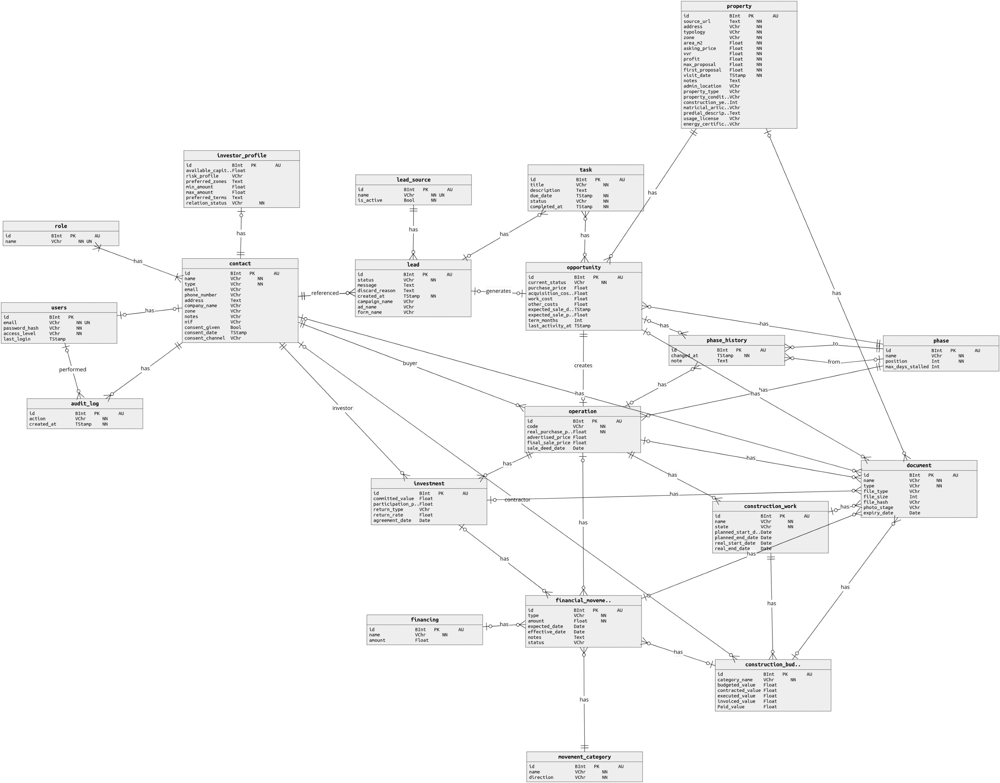

# Base de dados

Documentação do modelo de dados do projeto Imoventures.

**Versão atual: v2**

## Ficheiros

| Ficheiro | Descrição |
|---|---|
| `v2/ER.png` | Diagrama entidade-relação |
| `v2/ER_ImoVentures_v2.json` | Modelo editável em https://onda.dei.uc.pt/v4/ |
| `v2/schema.sql` | Cópia de referência do SQL. O código em uso está em [`database/schema.sql`](../../database/schema.sql) |

## Entidades

| Entidade | Descrição |
|---|---|
| `contact` | Pessoas e empresas (compradores, investidores, empreiteiros) |
| `lead` | Contacto inicial que pode originar uma oportunidade |
| `opportunity` | Negócio em análise, antes da compra |
| `property` | Imóvel associado a uma oportunidade |
| `operation` | Negócio já fechado, em execução |
| `investment` | Investimento de um contacto numa operação |
| `construction_work` | Obra de uma operação |
| `construction_budget_item` | Rubricas de orçamento da obra |
| `financial_movement` | Entradas e saídas de dinheiro |
| `phase` | Fases do processo |
| `phase_history` | Histórico de mudanças de fase de oportunidades e operações |
| `investor_profile` | Perfil de investimento de um contacto investidor |
| `role` | Papéis que um contacto pode ter |
| `movement_category` | Categorias dos movimentos financeiros (entrada ou saída) |
| `users` | Utilizadores com acesso à aplicação |
| `lead_source` | Origens das leads |
| `task` | Tarefas de acompanhamento de leads e oportunidades |
| `document` | Documentos associados às entidades do projeto |
| `audit_log` | Registo de ações realizadas por contactos |
| `financing` | Financiamento associado a movimentos financeiros |

## Versões

| Versão | Estado | Notas |
|---|---|---|
| v1 | antiga | Modelo inicial |
| v2 | atual | Modelo ampliado com documentação, auditoria e financiamento |